# NIVORA — Sistem Pengurusan Pesanan & Untung Kuih

Sistem web sebenar (bukan prototaip) untuk peniaga kuih Malaysia: rekod tempahan,
jadual pengambilan, kalkulator kos resipi, dan laporan untung bersih — dengan
dua peranan pengguna (**Peniaga** dan **Pentadbir**) serta pangkalan data sebenar.
Setiap tempahan pelanggan masuk ke papan pemuka peniaga; **peniaga** yang
mengesahkan tempahan dan menghantar **resit digital WhatsApp** kepada pelanggan.
Resit tidak dihantar secara automatik kepada pelanggan.

**Tema visual:** Hijau Daun Pisang — utama `#2D6A4F`, aksen `#40916C` /
`#52B788`, latar `#F2F9F4`, teks `#1B4332`, sempadan `#B7E4C7`. Logo NIVORA
dalam `public/img/nivora-mark.png` (dijana daripada `scripts/build-logo.py`).

Antara muka dibina semula daripada `sistem_pengurusan_pesanan_untung_kuih.html`
dengan reka bentuk yang lebih lengkap: shell aplikasi, navigasi mengikut peranan,
carta, jadual boleh cari, drawer butiran, modul penuh dan borang pelanggan awam.

| Log masuk | Papan pemuka |
| --- | --- |
| 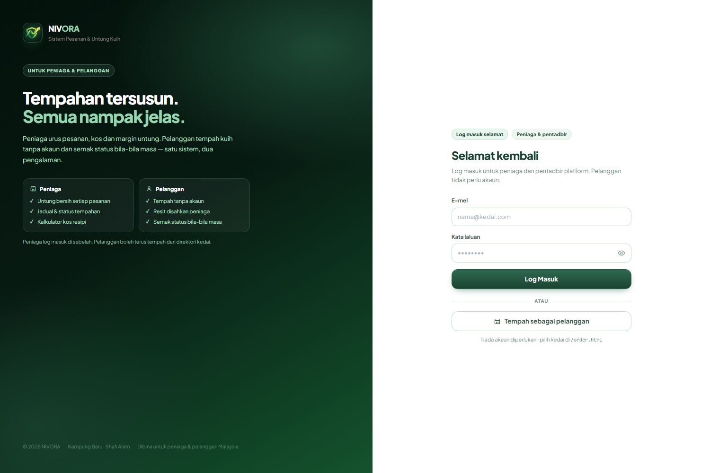 | 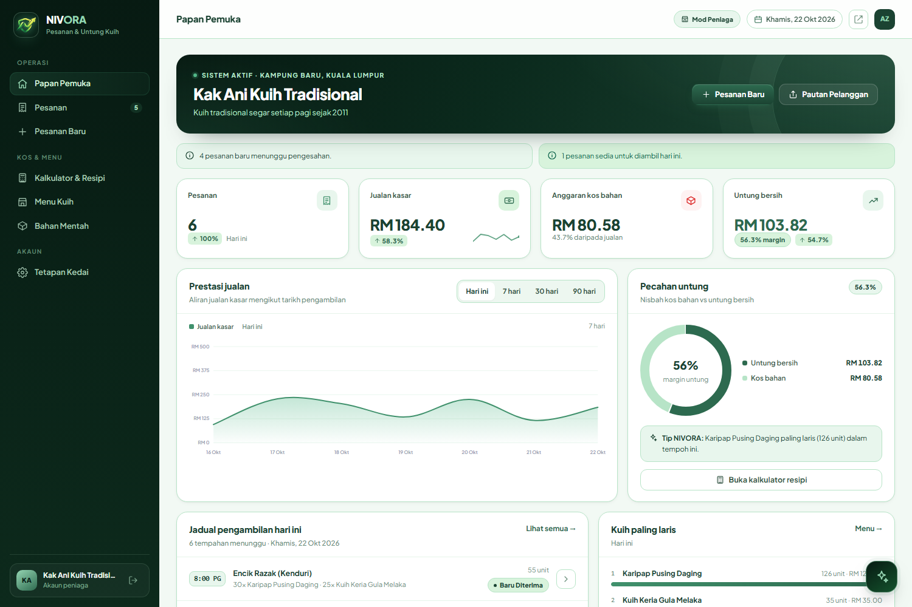 |

| Pesanan | Kalkulator resipi |
| --- | --- |
| 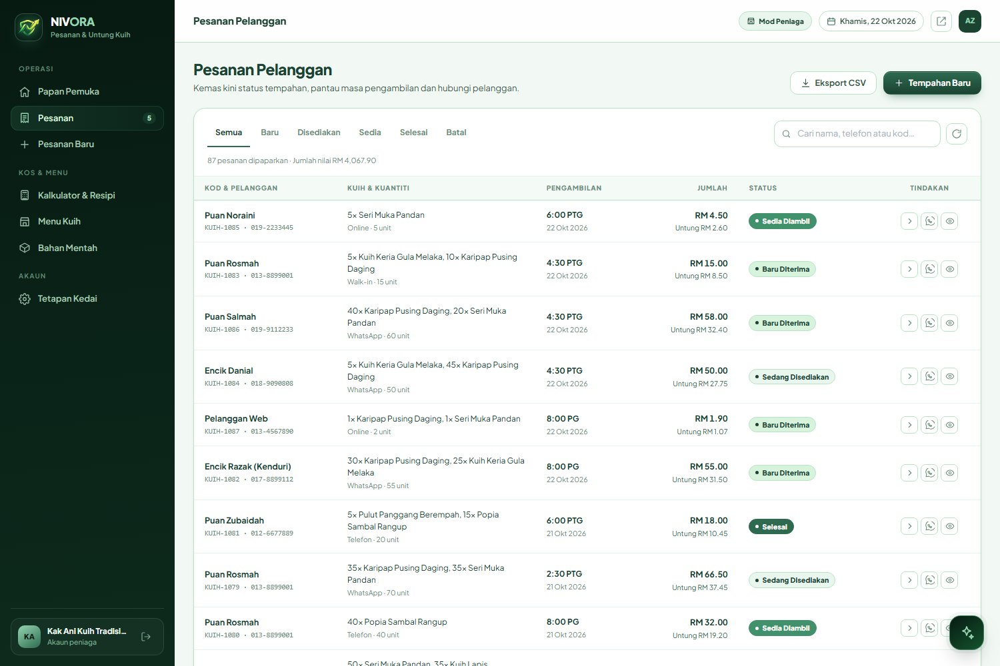 | 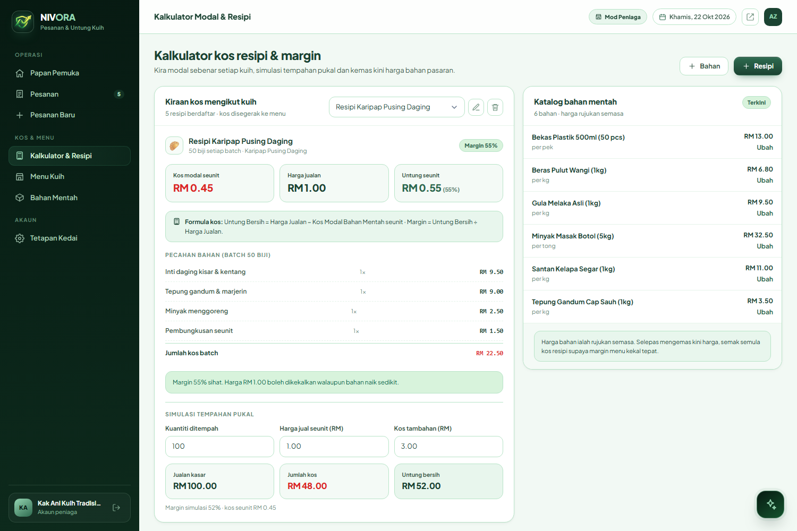 |

| Pentadbir | Borang pelanggan awam |
| --- | --- |
| 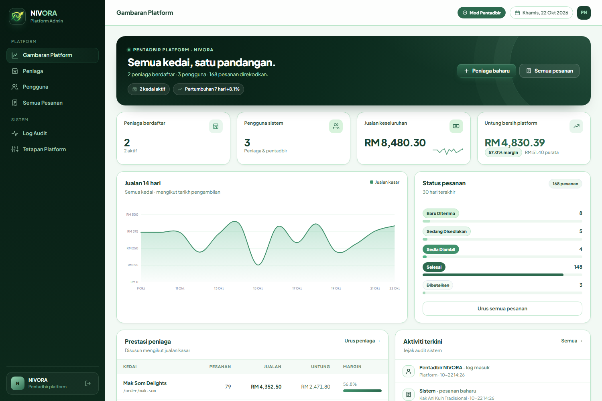 | 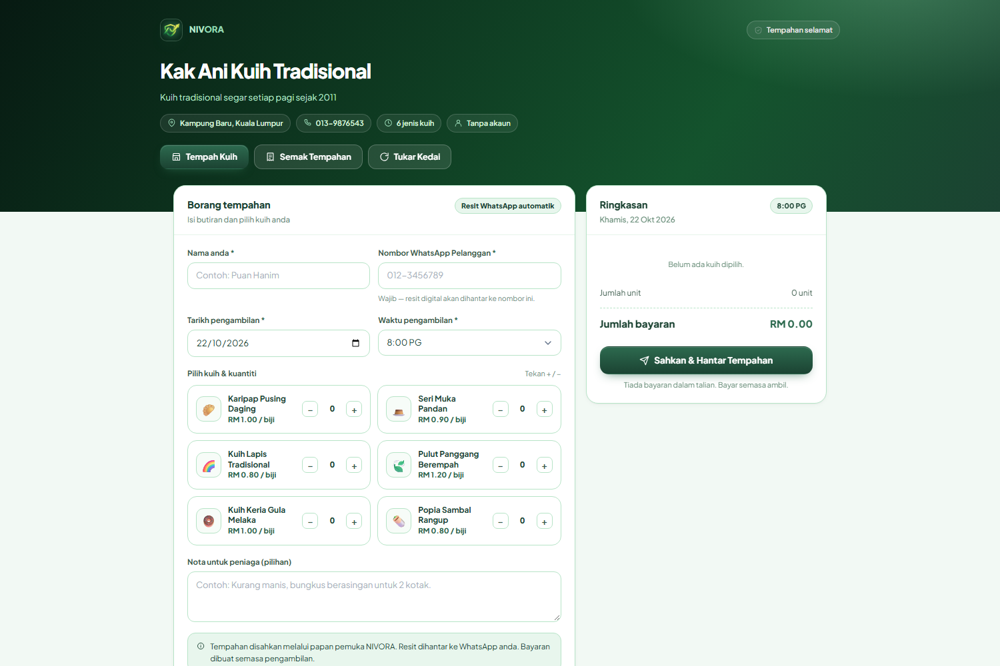 |

| Direktori kedai | Tukar kedai |
| --- | --- |
| 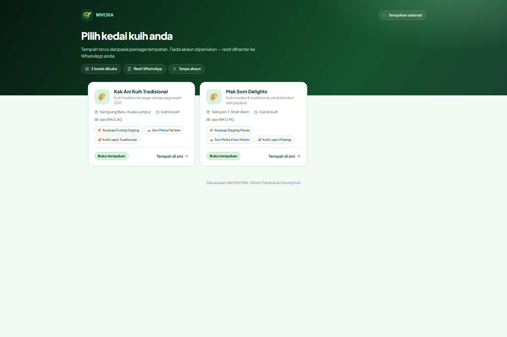 | 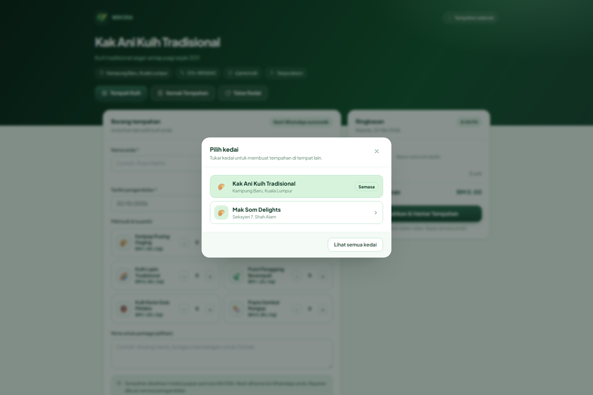 |

| Resit digital WhatsApp | Semakan status pelanggan |
| --- | --- |
| 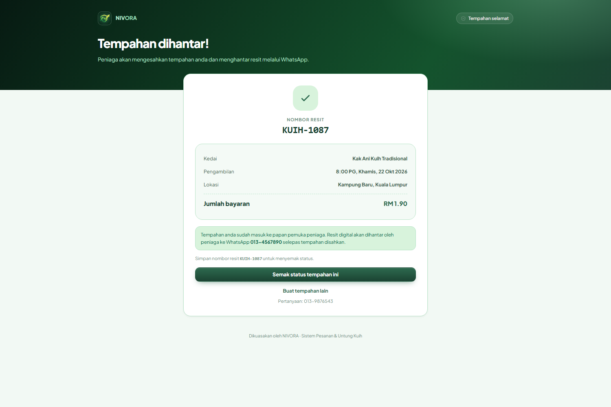 | 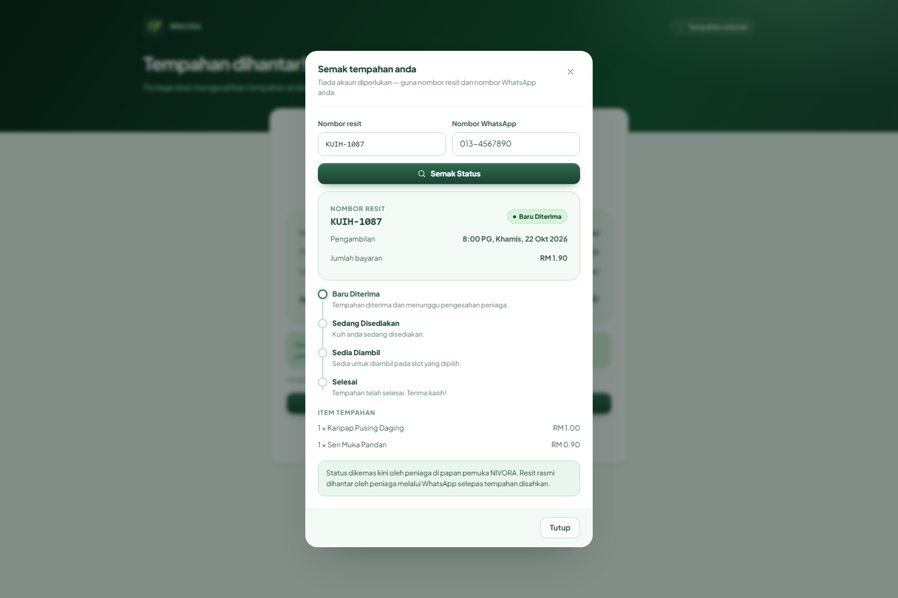 |

| Peniaga menghantar resit |
| --- |
| 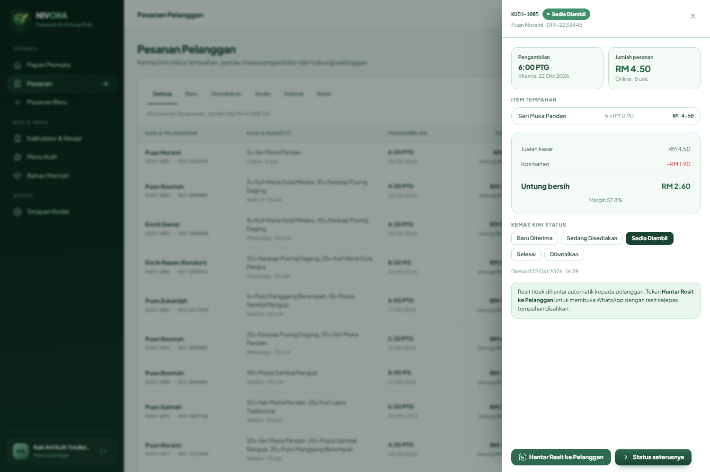 |

---

## 1. Mula pantas

```bash
cd obsidian-app
node server.js
```

Buka **http://127.0.0.1:4173**

Tiada `npm install` diperlukan — pelayan menggunakan modul terbina dalam Node
(`node:http`, `node:sqlite`, `node:crypto`). Keperluan: **Node.js ≥ 22.5**
(diuji pada Node 24).

### Akaun demo

| Peranan | E-mel | Kata laluan |
| --- | --- | --- |
| Pentadbir | `admin@nivora.my` | `admin123` |
| Peniaga | `kakani@nivora.my` | `user123` |
| Peniaga | `maksom@nivora.my` | `user123` |

Data demo (2 kedai, 10 menu, 5 resipi, ±170 pesanan dalam 26 hari) dijana
secara automatik pada jalan pertama.

### Arahan lain

```bash
npm start          # jalankan pelayan
npm run dev        # jalankan dengan --watch
npm run migrate    # jalankan migrasi skema sahaja
npm run seed       # isi data demo jika kosong
npm run reset      # padam semua data & seed semula (data demo bersih)
npm test           # ujian asap API (48 semakan)
npm run ui-check   # tangkap skrin semua halaman melalui Chrome headless
```

Tetapan melalui fail `.env` (lihat `.env.example`) atau pemboleh ubah persekitaran.

### Kongsi dengan pelanggan di rangkaian tempatan

```bash
HOST=0.0.0.0 node server.js
```

Kemudian kongsi `http://<IP-komputer-anda>:4173/order.html` (direktori semua
kedai) atau pautan kedai tertentu seperti
`http://<IP-komputer-anda>:4173/order.html?t=kak-ani`.
Pautan dalam butang **Pautan Pelanggan** menggunakan alamat yang sedang dibuka,
jadi buka aplikasi melalui IP tersebut untuk menghasilkan pautan yang betul.

> **Reset data demo:** hentikan pelayan dahulu, kemudian jalankan
> `npm run reset`. Menjalankan reset semasa pelayan aktif boleh menyebabkan
> hash kata laluan akaun demo tidak sepadan.

### Docker (pilihan)

```bash
docker compose up -d --build      # http://localhost:8080
docker compose logs -f
```

Data disimpan dalam volum `nivora-data` (`/data/nivora.db`) supaya kekal
merentas rekreasi kontena.

---

## 2. Kumpulan sasaran & akses

Sistem ini mempunyai **tiga pengguna berbeza** dengan antara muka berasingan:

| Kumpulan | Siapa | Login? | Antara muka |
| --- | --- | --- | --- |
| **Peniaga** (`user`) | Pemilik kedai kuih | Ya | Papan pemuka kedai sendiri: pesanan, menu, bahan, resipi, tetapan kedai |
| **Pentadbir** (`admin`) | Pengendali platform NIVORA | Ya | Konsol platform: semua kedai, pengguna, pesanan rentas kedai, audit, tetapan |
| **Pelanggan** | Pembeli kuih | **Tidak** | Halaman awam kedai: tempah kuih, semak status, resit dihantar oleh peniaga |

Pelanggan tidak perlu mendaftar akaun. Mereka membuka `/order.html` untuk memilih
kedai (atau pautan terus `/order.html?t=kak-ani`), membuat tempahan, dan menyemak
status menggunakan **nombor resit + nombor WhatsApp** — tiada kata laluan,
tiada profil.

Setiap peranan melihat navigasi dan halaman yang berbeza selepas log masuk:
peniaga mendapat **Mod Peniaga** (sidebar operasi kedai), pentadbir mendapat
**Mod Pentadbir** (sidebar platform). Pelanggan tidak melihat sebarang menu
dalaman atau data kewangan.

| Keupayaan | Peniaga (`user`) | Pentadbir (`admin`) | Pelanggan (awam) |
| --- | --- | --- | --- |
| Papan pemuka kedai sendiri | ✅ | — | — |
| Papan pemuka semua kedai | — | ✅ | — |
| Cipta / kemas kini / batalkan pesanan | ✅ | ✅ (semua kedai) | — |
| Tukar status pesanan | ✅ | ✅ | — |
| Urus menu, bahan mentah, resipi | ✅ | Lihat menu mana-mana kedai | — |
| Borang pesanan awam | ✅ | — | ✅ |
| Semak status tempahan | ✅ | ✅ | ✅ (resit + telefon) |
| Daftar / gantung kedai | — | ✅ | — |
| Urus akaun & reset kata laluan | — | ✅ | — |
| Log audit | — | ✅ | — |
| Tetapan platform (slot, ambang margin) | — | ✅ | — |

Setiap endpoint disemak di pelayan (`requireMerchant` / `requireAdmin`), bukan
hanya disembunyikan di UI. Peniaga hanya boleh melihat dan mengubah data
`tenant_id` miliknya — semua pertanyaan pesanan, menu, resipi dan bahan ditapis
mengikut tenant pada lapisan repositori.

Terdapat juga **borang pelanggan awam** tanpa log masuk:
`/order.html?t=kak-ani` — tempahan masuk terus ke senarai peniaga sebagai
status *Baru Diterima*.

---

## 3. Ciri utama

**Papan pemuka peniaga**
- Kad metrik: pesanan, jualan kasar, kos bahan, untung bersih + margin
- Perbandingan tempoh (delta %) berbanding tempoh sebelumnya
- Carta aliran jualan (SVG, tanpa pustaka luar) untuk 7/30/90 hari
- Donut pecahan untung vs kos
- Jadual pengambilan hari ini + butang majukan status
- Kuih paling laris, tempahan terkini, amaran automatik (pesanan baru,
  sedia diambil, margin nipis)

**Pesanan**
- Cari nama / telefon / kod, penapis status, eksport CSV
- Drawer butiran: item, kos, untung, margin, nota, tukar status
- Status: Baru Diterima → Sedang Disediakan → Sedia Diambil → Selesai (+ Dibatalkan)
- **Rekod Manual** untuk pesanan walk-in, telefon atau WhatsApp — butang pada
  halaman Pesanan dan Papan Pemuka (bukan menu sidebar), borang ringkas tanpa
  input suara
- Peniaga **tidak** menerima mesej WhatsApp — semua pengurusan status dibuat
  terus di papan pemuka web NIVORA
- Resit digital dihantar **oleh peniaga** melalui butang **Hantar Resit ke
  Pelanggan** (ikon WhatsApp pada senarai pesanan atau butang dalam drawer)

**Borang pesanan pelanggan**
- Nombor WhatsApp pelanggan **wajib** diisi sebelum tempahan dihantar
- Input suara Bahasa Melayu (Web Speech API, `ms-MY`) + simulasi
- Penghurai ayat: nama pelanggan, kuantiti, nama kuih, tarikh (“esok”/“lusa”),
  masa (“pukul 4:30 petang” dipadankan ke slot terdekat)
- Ringkasan langsung dengan anggaran untung dan diskaun
- Selepas hantar: pesanan disimpan ke pangkalan data dan muncul di papan pemuka
  peniaga. **Tiada WhatsApp dibuka secara automatik** — peniaga menghantar resit
  selepas tempahan disahkan

**Portal pelanggan (tanpa akaun)**
- Halaman awam `/order.html` memaparkan direktori semua kedai aktif — pelanggan
  memilih peniaga sebelum menempah (tiada akaun diperlukan)
- Butang **Tukar Kedai** pada halaman kedai membuka senarai peniaga tanpa
  meninggalkan halaman tempahan
- Semakan status guna nombor resit + nombor WhatsApp, tanpa log masuk
- Garis masa status: Baru Diterima → Sedang Disediakan → Sedia Diambil → Selesai
- Resit tidak dipaparkan untuk dihantar oleh pelanggan — peniaga menghantarnya
  melalui WhatsApp selepas pengesahan

**Kalkulator & resipi**
- Formula dipaparkan pada skrin: **Untung Bersih = Harga Jualan − Kos Modal
  Bahan Mentah seunit**, dengan margin = untung ÷ harga jualan
- Kos seunit = jumlah kos batch ÷ hasil (yield)
- Pecahan bahan, margin, cadangan harga
- Simulasi tempahan pukal (kuantiti, harga, kos tambahan)
- Katalog bahan mentah dengan kemas kini harga
- Menyimpan resipi menyegerakkan kos menu kuih secara automatik

**Pentadbir**
- Gambaran platform: jumlah kedai, pengguna, pesanan, jualan, untung
- Prestasi setiap peniaga + carta 14 hari
- CRUD kedai (termasuk gantung/aktif), pengguna, reset kata laluan
- Semua pesanan rentas kedai + eksport CSV
- Log audit (aktor, tindakan, entiti, butiran JSON)
- Tetapan platform: nama, tagline, slot pengambilan, ambang amaran margin

**Pembantu data** (butang ✨)
- Menjawab soalan kos/untung/harga/menu/pesanan daripada data sebenar
- Contoh: “Kira untung 100 biji karipap (kos RM0.45, jual RM1.00)” →
  jadual pengiraan lengkap; “Kuih mana paling untung?” → kedudukan margin
- Deterministik dan boleh disemak (tiada panggilan AI luaran)

### Aliran resit digital WhatsApp (dihantar oleh peniaga)

1. Pelanggan membuka `/order.html`, memilih kedai/kuih dan mengisi
   **Nombor WhatsApp Pelanggan** (`id="custPhone"`, wajib).
2. Butang **Sahkan & Hantar Tempahan** menyimpan `orders` + `order_items` dan
   menjana nombor resit `KUIH-####`. **Tiada WhatsApp dibuka automatik.**
3. Pelanggan melihat mesej: “Peniaga akan mengesahkan tempahan anda dan
   menghantar resit melalui WhatsApp.” Halaman semakan status juga tidak
   memaparkan butang resit WhatsApp.
4. Peniaga membuka **Pesanan** → butang WhatsApp pada baris pesanan, atau
   **Hantar Resit ke Pelanggan** dalam drawer. Pelayan membina resit dan membuka
   `https://wa.me/60…?text=…` ke nombor pelanggan; peniaga menekan **Hantar**
   dalam WhatsApp.
5. Resit yang dihantar:

```
🧾 *RESIT PENGESAHAN TEMPAHAN - NIVORA*
----------------------------------------
*Kedai:* Kak Ani Kuih Tradisional
*No. Tempahan:* #KUIH-1086
*Nama Pelanggan:* Puan Salimah
*Tarikh & Masa Ambil:* Khamis, 22 Okt 2026, 4:30 PTG

📋 *SENARAI PESANAN:*
• 40 × Karipap Pusing Daging @ RM 1.00 = RM 40.00
• 20 × Seri Muka Pandan @ RM 0.90 = RM 18.00
----------------------------------------
💰 *JUMLAH BAYARAN:* *RM 58.00*
📌 *STATUS:* Tempahan Diterima
----------------------------------------
_Sila simpan resit ini dan tunjukkan semasa waktu pengambilan kuih._
Terima kasih kerana menempah melalui NIVORA!
```

6. Peniaga menguruskan status di web; tiada notifikasi WhatsApp dihantar kepada
   peniaga.

---

## 4. Seni bina

```
server.js
  └─ src/lib/http.js ............ pelayan HTTP kecil (router, static, JSON, cookie, CSRF)
  └─ src/db/index.js ............ pemilih pemacu + bootstrap
       ├─ drivers/sqlite.js ..... node:sqlite (lalai)
       └─ drivers/postgres.js ... stub sedia untuk migrasi (pg)
     migrations/001_init.sql .... DDL mudah alih
     seed.js .................... data demo deterministik
     repositories/*.repo.js ..... SATU-SATUNYA lapisan yang menulis SQL
  └─ src/services/*.service.js .. logik perniagaan (auth, pesanan, katalog, laporan)
  └─ src/routes/*.routes.js ..... endpoint REST mengikut peranan
  └─ src/middleware/auth.js ..... sesi & semakan peranan
public/ ........................ SPA vanilla ES modules + CSS tersendiri
  js/core/ ...................... api, ui, charts, format, markdown, icons, state, receipt
  js/views/merchant|admin/ ...... halaman mengikut peranan
  order.html .................... borang pelanggan awam
```

Prinsip penting:

1. **Wang sebagai integer sen** (`price_cents`, `total_cents`). Tiada ralat
   pembundaran terapung; format RM hanya di lapisan paparan.
2. **Snapshot harga dalam pesanan.** `order_items` menyimpan harga & kos semasa.
   Mengubah menu kemudian tidak mengubah laporan lama.
3. **Repositori = satu-satunya tempat SQL.** Servis tidak tahu sama ada
   pangkalan data itu SQLite atau PostgreSQL. Lihat `docs/MIGRATION.md`.
4. **Sesi pelayan.** Token rawak 32 bait; hanya hash SHA-256 disimpan dalam
   `sessions`; cookie `HttpOnly`, `SameSite=Lax`, tamat 7 hari.
5. **Kata laluan scrypt** (N=16384) dengan garam rawak, dibandingkan secara
   pemalar-masa.

### Skema pangkalan data

| Jadual | Tujuan |
| --- | --- |
| `tenants` | Kedai/peniaga (slug untuk pautan awam) |
| `users` | Akaun, peranan (`admin`/`user`), hash kata laluan |
| `sessions` | Sesi log masuk (hash token, tamat tempoh) |
| `kuih` | Menu: harga jual, kos seunit, status |
| `ingredients` | Katalog bahan mentah + harga rujukan |
| `recipes`, `recipe_items` | Resipi batch, hasil, pecahan kos |
| `orders`, `order_items` | Pesanan + snapshot harga/kos setiap baris |
| `audit_logs` | Jejak tindakan (aktor, entiti, butiran JSON) |
| `settings` | Tetapan platform (JSON per kunci) |
| `counters` | Penjana kod pesanan `KUIH-####` per kedai |
| `schema_migrations` | Migrasi yang telah digunakan |

---

## 5. API ringkas

Semua respons: `{ "data": ... }` atau `{ "error": { message, code, details } }`.

| Kaedah | Laluan | Akses |
| --- | --- | --- |
| POST | `/api/auth/login` · `/logout` · `/password` | awam / sesi |
| GET | `/api/auth/me` | sesi |
| GET | `/api/dashboard?range=today\|7d\|30d\|90d\|all` | peniaga |
| GET/POST | `/api/orders` | peniaga |
| GET | `/api/orders/:id` · `/:id/whatsapp` | peniaga |
| PATCH | `/api/orders/:id/status` | peniaga |
| POST | `/api/orders/:id/advance` | peniaga |
| GET/POST/PATCH/DELETE | `/api/kuih` · `/api/ingredients` · `/api/recipes` | peniaga |
| GET/PATCH | `/api/tenant` | peniaga |
| POST | `/api/assistant` | peniaga |
| GET | `/api/admin/overview` · `/tenants` · `/users` · `/orders` · `/audit` · `/settings` | pentadbir |
| POST/PATCH/DELETE | `/api/admin/tenants` · `/users` · `/settings` · `/orders/:id/status` | pentadbir |
| GET | `/api/public/tenants/:slug` | awam |
| POST | `/api/public/orders` | awam (dihadkan kadar) |
| GET | `/api/health` | awam |

Butiran penuh: [`docs/API.md`](docs/API.md).

---

## 6. Keselamatan

- Semua mutasi menyemak `Origin` / `Sec-Fetch-Site` (pertahanan CSRF).
- Semua SQL menggunakan parameter `?` (tiada penggabungan rentetan).
- Semua output pengguna di-escape sebelum masuk HTML; renderer markdown
  pembantu meng-escape teks dahulu.
- Had cubaan log masuk: 8 cubaan / 10 minit per IP+e-mel.
- Had tempahan awam: 8 / 10 minit per IP.
- Perubahan kata laluan menamatkan semua sesi pengguna.
- Gantung kedai membatalkan akses peniaga tetapi mengekalkan data.
- Setiap tindakan penting ditulis ke `audit_logs`.

Untuk produksi: jalankan di belakang HTTPS, tetapkan `NODE_ENV=production`
(cookie `Secure`), dan gunakan had kadar di peringkat proksi.

---

## 7. Had semasa (jujur)

- Penghad kadar disimpan dalam memori proses — satu proses sahaja.
- Tiada e-mel transaksi / pengesahan akaun; akaun dicipta oleh pentadbir.
- Tiada integrasi bayaran; bayaran dibuat semasa pengambilan.
- Input suara bergantung pada sokongan `SpeechRecognition` pelayar
  (Chrome/Edge). Kotak teks + butang simulasi disediakan sebagai ganti.
- Kos resipi disimpan sebagai snapshot baris; menukar harga bahan tidak
  mengira semula resipi secara automatik (UI meminta semakan semula).
- Pemacu PostgreSQL disediakan tetapi belum diuji dengan pangkalan data hidup.

---

## 8. Struktur fail

```
obsidian-app/
├── server.js
├── package.json
├── .env.example
├── data/nivora.db            (dijana)
├── docs/{API.md,MIGRATION.md}
├── scripts/{smoke-test.js,ui-check.mjs,console-check.mjs,set-password.js}
├── src/
│   ├── config.js
│   ├── lib/{http,errors,time,money,password,validate}.js
│   ├── db/{index,migrate,seed}.js + drivers/ + migrations/ + repositories/
│   ├── services/{auth,catalog,orders,dashboard,platform,assistant,container}.js
│   ├── middleware/auth.js
│   └── routes/{auth,merchant,admin,public}.routes.js
└── public/
    ├── index.html · app.html · order.html
    ├── css/app.css
    └── js/{app,login,assistant,public-order}.js + core/ + views/
```

---

© 2026 NIVORA · Dibina untuk peniaga kuih Malaysia.
